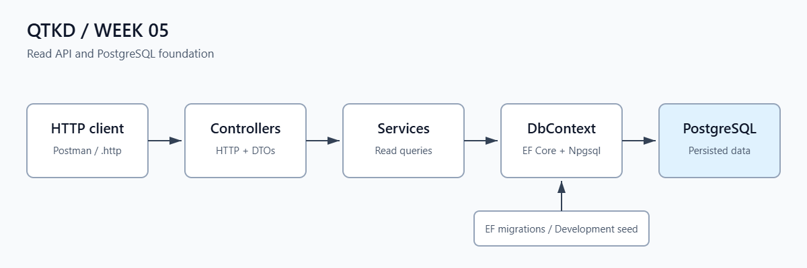
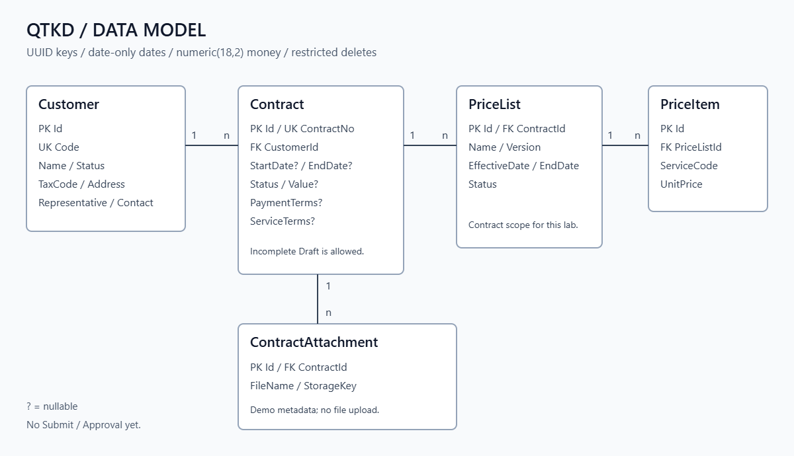
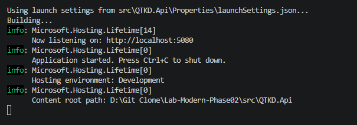
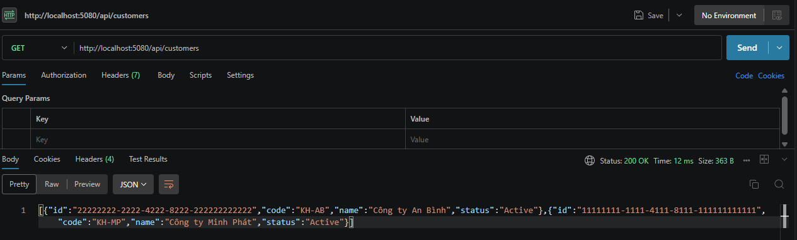
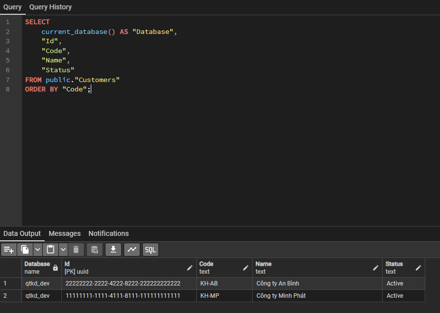
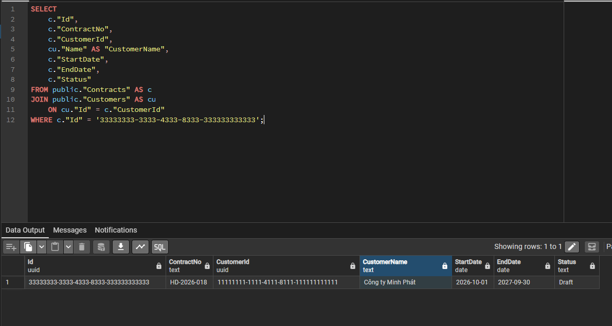

# Báo cáo thực hành tuần 05

**Đề tài:** Xây dựng hệ thống Quản trị kinh doanh QTKD
**Giai đoạn:** Phase 2, tạo nền tảng ứng dụng và API đọc dữ liệu

Tuần 05 xây dựng nền tảng ASP.NET Core Web API kết nối PostgreSQL, tạo mô hình dữ liệu và đọc thông tin khách hàng, hợp đồng từ database. Kết quả chạy ứng dụng được minh chứng bằng ảnh terminal, phản hồi Postman và truy vấn pgAdmin 4. Dữ liệu Customer và Contract trả về từ API khớp với dữ liệu truy vấn trực tiếp trong database `qtkd_dev`.

## 1 Mục tiêu và phạm vi

Các mục tiêu của tuần 05 gồm:

- Tạo một solution dùng tiếp cho tuần 06 và tuần 07, phân biệt trách nhiệm API, xử lý nghiệp vụ và truy cập dữ liệu.
- Xây dựng các entity Customer, Contract, PriceList và PriceItem; bổ sung metadata tệp đính kèm để chuẩn bị cho hợp đồng.
- Cấu hình Entity Framework Core với PostgreSQL, tạo migration và chuẩn bị dữ liệu mẫu.
- Cung cấp `GET /api/customers` và `GET /api/contracts/{id}`.
- Đối chiếu phản hồi API với dữ liệu trong PostgreSQL và mô tả cách chạy lại ứng dụng.

Kết quả Phase 1 được sử dụng làm đầu vào cho US03: nhân viên Kinh doanh gửi hợp đồng đã hoàn thiện để các bên có thẩm quyền xem xét và phê duyệt. Trong tuần 05, US03 được chuẩn bị về dữ liệu và trạng thái; endpoint Submit, phân quyền, workflow phê duyệt, giao diện web và ký điện tử chưa được triển khai.

## 2 Môi trường và công nghệ

| Thành phần           | Công nghệ hoặc cấu hình                                        |
| ---------------------- | ------------------------------------------------------------------- |
| Ngôn ngữ             | C#                                                                  |
| Framework              | ASP.NET Core Web API, target `net10.0`                            |
| .NET SDK               | `10.0.403`, khai báo trong `global.json`                       |
| ORM và migration      | Entity Framework Core và công cụ `dotnet-ef` dòng `10.0.15` |
| PostgreSQL provider    | `Npgsql.EntityFrameworkCore.PostgreSQL 10.0.4`                    |
| Database               | PostgreSQL, database `qtkd_dev`                                   |
| API khi chạy local    | `http://localhost:5080`                                           |
| Kiểm tra API          | Postman                                                             |
| Đối chiếu dữ liệu | pgAdmin 4, Query Tool                                               |
| Cấu hình kết nối   | User Secrets trong Development hoặc biến môi trường            |

Chuỗi kết nối được đọc từ khóa `ConnectionStrings:Qtkd`. Mật khẩu không được ghi trong mã nguồn hoặc cấu hình đưa lên Git. Dữ liệu API được truy vấn bằng EF Core từ PostgreSQL, không sử dụng danh sách dữ liệu mẫu viết trực tiếp trong Controller hoặc Service.

## 3 Quá trình thực hiện theo bảy bước

### Bước 1 Tạo solution và tổ chức Web API

Solution `QTKD.sln` chứa project `QTKD.Api`. Mã nguồn được tổ chức theo các thư mục có trách nhiệm riêng:

| Thành phần | Trách nhiệm                                                                              |
| ------------ | ------------------------------------------------------------------------------------------ |
| Controllers  | Tiếp nhận HTTP request, binding tham số và trả HTTP response                          |
| DTOs         | Xác định cấu trúc dữ liệu trả về cho client                                       |
| Services     | Thực hiện các truy vấn phục vụ nghiệp vụ; chuẩn bị điểm mở rộng cho tuần 06 |
| Domain       | Định nghĩa entity và enum trạng thái                                                 |
| Data         | Quản lý DbContext, ánh xạ dữ liệu, migration và seeder                              |

Luồng đọc dữ liệu là HTTP client → Controller → Service → QtkdDbContext → PostgreSQL. Công cụ migration và seeder sử dụng cùng lớp Data để tạo cấu trúc và nạp dữ liệu.



*Hình 1. Các thành phần chính và luồng truy cập PostgreSQL của solution tuần 05.*

### Bước 2 Xây dựng các entity và mô hình dữ liệu

Mô hình gồm bốn entity chính của bài thực hành và một entity bổ sung phục vụ metadata tệp đính kèm:

| Entity             | Thuộc tính chính                                                                       | Vai trò                                                                              |
| ------------------ | ----------------------------------------------------------------------------------------- | ------------------------------------------------------------------------------------- |
| Customer           | Id, Code, Name, Status; TaxCode, Address, RepresentativeName, ContactInfo                 | Lưu thông tin khách hàng                                                          |
| Contract           | Id, ContractNo, CustomerId, StartDate, EndDate, Status, Value, PaymentTerms, ServiceTerms | Lưu hồ sơ hợp đồng và liên kết khách hàng                                  |
| PriceList          | Id, Name, ContractId, EffectiveDate, EndDate, Version, Status                             | Lưu bảng giá theo hợp đồng trong phạm vi bản thực hành                      |
| PriceItem          | Id, PriceListId, ServiceCode, UnitPrice                                                   | Lưu các dòng dịch vụ và đơn giá của bảng giá                              |
| ContractAttachment | Id, ContractId, FileName, StorageKey                                                      | Chuẩn bị metadata tệp đính kèm, chưa xử lý upload hoặc kiểm tra tệp thật |

Các quan hệ được xác định như sau:

- Một Customer có nhiều Contract; mỗi Contract thuộc một Customer.
- Một Contract có nhiều PriceList; mỗi PriceList có nhiều PriceItem.
- Một Contract có nhiều ContractAttachment.



*Hình 2. Quan hệ giữa Customer, Contract, PriceList, PriceItem và ContractAttachment. Dấu hỏi thể hiện thuộc tính cho phép null trong phần Contract.*

Khóa định danh dùng UUID. Ngày hiệu lực được biểu diễn bằng `DateOnly` trong C# và kiểu `date` trong PostgreSQL. Giá trị tiền dùng `decimal` và `numeric(18,2)`. Trạng thái được lưu dưới dạng chuỗi.

Contract cho phép thiếu ngày, giá trị hoặc điều khoản khi còn là bản nháp. Việc kiểm tra điều kiện hoàn thiện hồ sơ để gửi trình duyệt sẽ được thực hiện ở tuần 06. Trong bản thực hành này, bảng giá áp dụng theo Contract; các phạm vi bảng giá khác chưa được xây dựng.

### Bước 3 Tạo DbContext và cấu hình PostgreSQL

`QtkdDbContext` khai báo các tập dữ liệu Customers, Contracts, PriceLists, PriceItems và ContractAttachments. Phần cấu hình EF Core xác định khóa chính, khóa ngoại và các ràng buộc dữ liệu:

- Code của Customer và ContractNo của Contract có unique index.
- Các quan hệ sử dụng khóa ngoại; EF Core tạo index cho các cột khóa ngoại theo convention.
- Hành vi xóa được cấu hình `Restrict`, tránh xóa dây chuyền dữ liệu có liên kết.
- Cột Status được chuyển đổi từ enum sang chuỗi và có check constraint giới hạn các giá trị được phép lưu.

DbContext được đăng ký trong Dependency Injection bằng `UseNpgsql`. Các Service truy vấn bất đồng bộ, dùng `AsNoTracking` cho thao tác đọc và chiếu kết quả sang DTO để không trả trực tiếp toàn bộ entity cùng navigation property.

### Bước 4 Tạo migration đầu tiên và cập nhật database

Migration đầu tiên có tên `InitialCreate`, định nghĩa năm bảng nghiệp vụ cùng các khóa và index tương ứng. Khi áp dụng bằng EF Core, database còn có bảng `__EFMigrationsHistory` để theo dõi migration đã thực hiện.

Lệnh cập nhật database, chạy tại thư mục gốc repository:

```powershell
dotnet ef database update --project src/QTKD.Api
```

Các ảnh pgAdmin ở phần minh chứng cho thấy bảng Customers và Contracts đã tồn tại, có dữ liệu và truy vấn được. Cấu trúc PriceList, PriceItem và ContractAttachment được khai báo trong mô hình và migration; bộ ảnh hiện tại chưa bao gồm truy vấn riêng cho ba bảng này.

### Bước 5 Chuẩn bị dữ liệu mẫu

`DevelopmentSeeder` định nghĩa bộ dữ liệu minh họa với UUID cố định:

| Dữ liệu           | Nội dung mẫu                                                                  |
| ------------------- | ------------------------------------------------------------------------------- |
| Customer 1          | KH-MP, Công ty Minh Phát, Active                                              |
| Customer 2          | KH-AB, Công ty An Bình, Active                                                |
| Contract            | HD-2026-018, thuộc Công ty Minh Phát, trạng thái Draft                     |
| Thời hạn Contract | Từ 01/10/2026 đến 30/09/2027                                                 |
| PriceList           | Bảng giá dịch vụ Minh Phát bản nháp, Version 1, liên kết Contract mẫu |
| PriceItem 1         | BOC_XEP, đơn giá 250000.00                                                   |
| PriceItem 2         | LUU_KHO, đơn giá 150000.00                                                   |

Seeder chỉ được chạy trong môi trường Development, kiểm tra migration còn chờ và thực hiện nạp dữ liệu trong transaction. Bản ghi đã có theo UUID được giữ nguyên; chạy lại seeder chỉ bổ sung bản ghi mẫu còn thiếu.

```powershell
dotnet run --project src/QTKD.Api -- --seed
```

Contract mẫu có `ServiceTerms = null` và danh sách attachment rỗng. Đây là bản nháp chưa hoàn thiện, được giữ lại để tiếp tục tình huống gửi thiếu dữ liệu → bổ sung → gửi lại ở tuần 06. Ngày hiện tại không tự chuyển Contract từ Draft sang Active.

### Bước 6 Xây dựng API đọc và đối chiếu PostgreSQL

Hai endpoint nghiệp vụ được triển khai:

| Phương thức | Endpoint                | Phản hồi                                                                |
| -------------- | ----------------------- | ------------------------------------------------------------------------- |
| GET            | `/api/customers`      | HTTP 200 và danh sách Customer; trả `[]` nếu chưa có dữ liệu    |
| GET            | `/api/contracts/{id}` | HTTP 200 và chi tiết Contract, Customer liên quan, metadata attachment |

Đối với endpoint chi tiết Contract, mã nguồn xử lý UUID sai định dạng bằng HTTP 400 và Contract không tồn tại bằng HTTP 404. Các lỗi sử dụng Problem Details. Bộ ảnh dưới đây tập trung vào hai trường hợp đọc dữ liệu thành công.

#### 6.1 Khởi động API

Ứng dụng được khởi động bằng lệnh:

```powershell
dotnet run --project src/QTKD.Api
```



*Hình 3. Terminal hiển thị ứng dụng đã khởi động, lắng nghe tại http://localhost:5080 và sử dụng môi trường Development.*

#### 6.2 Đọc danh sách Customer bằng Postman

Request thực hiện:

```http
GET http://localhost:5080/api/customers
```



*Hình 4. GET Customer trả HTTP 200 OK và hai khách hàng Công ty An Bình, Công ty Minh Phát; cả hai có trạng thái Active.*

Phản hồi có các trường `id`, `code`, `name`, `status`. Customer được sắp xếp theo Code, vì vậy KH-AB xuất hiện trước KH-MP.

#### 6.3 Đọc chi tiết Contract bằng Postman

Request thực hiện:

```http
GET http://localhost:5080/api/contracts/33333333-3333-4333-8333-333333333333
```

.png)

*Hình 5. GET Contract trả HTTP 200 OK, số hợp đồng HD-2026-018, trạng thái Draft và thông tin khách hàng Công ty Minh Phát.*

Response đồng thời thể hiện thời hạn `2026-10-01` đến `2027-09-30`, `serviceTerms: null` và `attachments: []`, phù hợp với dữ liệu bản nháp đã chuẩn bị.

#### 6.4 Đối chiếu Customer trong pgAdmin 4

Truy vấn trực tiếp trên database:

```sql
SELECT
    current_database() AS "Database",
    "Id",
    "Code",
    "Name",
    "Status"
FROM public."Customers"
ORDER BY "Code";
```



*Hình 6. pgAdmin trả hai Customer trong database qtkd_dev, có Id, Code, Name và Status khớp với phản hồi API ở Hình 4.*

| Customer            | Id                                       | Kết quả đối chiếu                   |
| ------------------- | ---------------------------------------- | ---------------------------------------- |
| Công ty An Bình   | `22222222-2222-4222-8222-222222222222` | KH-AB, Active ở cả Postman và pgAdmin |
| Công ty Minh Phát | `11111111-1111-4111-8111-111111111111` | KH-MP, Active ở cả Postman và pgAdmin |

#### 6.5 Đối chiếu Contract và quan hệ Customer trong pgAdmin 4

Truy vấn sử dụng JOIN để kiểm tra Contract thuộc đúng Customer:

```sql
SELECT
    c."Id",
    c."ContractNo",
    c."CustomerId",
    cu."Name" AS "CustomerName",
    c."StartDate",
    c."EndDate",
    c."Status"
FROM public."Contracts" AS c
JOIN public."Customers" AS cu
    ON cu."Id" = c."CustomerId"
WHERE c."Id" = '33333333-3333-4333-8333-333333333333';
```



*Hình 7. Kết quả JOIN xác nhận hợp đồng HD-2026-018 thuộc Công ty Minh Phát và có thời hạn, trạng thái khớp với API ở Hình 5.*

| Trường đối chiếu | Giá trị ở API và PostgreSQL          |
| --------------------- | ---------------------------------------- |
| Id                    | `33333333-3333-4333-8333-333333333333` |
| ContractNo            | HD-2026-018                              |
| CustomerId            | `11111111-1111-4111-8111-111111111111` |
| CustomerName          | Công ty Minh Phát                      |
| StartDate             | 2026-10-01                               |
| EndDate               | 2027-09-30                               |
| Status                | Draft                                    |

Việc đối chiếu cả định danh, liên kết khách hàng, ngày và trạng thái xác nhận kết quả đọc của hai endpoint phù hợp với dữ liệu được lưu trong PostgreSQL.

### Bước 7 Hoàn thiện hướng dẫn chạy lại

Các lệnh sau được thực hiện tại thư mục gốc repository, nơi chứa `QTKD.sln`. Máy chạy cần có .NET SDK phù hợp, PostgreSQL đang hoạt động và tài khoản có quyền cập nhật schema. Nếu database chưa có, tài khoản phải có quyền tạo database hoặc database được tạo trước với owner phù hợp.

```powershell
dotnet tool restore
dotnet restore QTKD.sln --locked-mode
dotnet build QTKD.sln --no-restore

$env:ASPNETCORE_ENVIRONMENT = 'Development'
```

Cấu hình kết nối cục bộ, thay `MAT_KHAU_LOCAL` bằng mật khẩu PostgreSQL thực tế:

```powershell
dotnet user-secrets set 'ConnectionStrings:Qtkd' 'Host=localhost;Port=5432;Database=qtkd_dev;Username=postgres;Password=MAT_KHAU_LOCAL' --project src/QTKD.Api
```

Tiếp tục chạy migration, seed và API:

```powershell
dotnet ef database update --project src/QTKD.Api
dotnet run --project src/QTKD.Api -- --seed
dotnet run --project src/QTKD.Api
```

Sau khi API lắng nghe tại cổng 5080, gọi hai endpoint như phần minh chứng và kết nối pgAdmin tới cùng database `qtkd_dev` để chạy các câu SQL đã trình bày. Không tạo migration `InitialCreate` mới khi chạy lại trên máy khác; sử dụng migration có sẵn. Nếu đang đặt biến môi trường `ConnectionStrings__Qtkd`, giá trị đó sẽ được ưu tiên hơn User Secrets và cần trỏ tới đúng database cần kiểm tra.

Hướng dẫn đã có đủ các bước cấu hình, tạo database bằng migration, nạp mẫu và thử API. Việc nhờ một máy hoặc môi trường độc lập thực hiện lại toàn bộ các bước vẫn cần được bổ sung kết quả xác nhận.

## 4 Tổng hợp kết quả tuần 05

| Nội dung                             | Kết quả và minh chứng                                                                                                                                      |
| ------------------------------------- | -------------------------------------------------------------------------------------------------------------------------------------------------------------- |
| Tổ chức solution                    | Có project Web API và các thành phần phân tách trách nhiệm; Hình 1                                                                                   |
| Mô hình dữ liệu                   | Có bốn entity chính và metadata attachment; Hình 2                                                                                                        |
| Kết nối và chạy ứng dụng        | API chạy tại localhost:5080 trong Development; Hình 3                                                                                                       |
| Đọc Customer                        | HTTP 200, hai Customer có đủ dữ liệu trả về; Hình 4                                                                                                    |
| Đọc Contract                        | HTTP 200, Contract mẫu có Customer liên quan và trạng thái Draft; Hình 5                                                                                |
| Đối chiếu Customer với PostgreSQL | Khớp Id, Code, Name và Status; Hình 4 và Hình 6                                                                                                           |
| Đối chiếu Contract với PostgreSQL | Khớp Id, ContractNo, CustomerId, thời hạn và Status; Hình 5 và Hình 7                                                                                   |
| PriceList và PriceItem               | Có entity, cấu hình, migration và dữ liệu định nghĩa trong seeder; cần bổ sung ảnh truy vấn riêng nếu cần minh chứng trực quan phần Pricing |
| Khả năng chạy lại                 | Đã mô tả các lệnh; còn bước xác nhận từ máy hoặc môi trường độc lập                                                                        |

Kết quả chính đạt được là một nền tảng API có thể đọc Customer và Contract từ PostgreSQL, kèm mô hình và dữ liệu chuẩn bị cho các chức năng ghi ở tuần tiếp theo.
